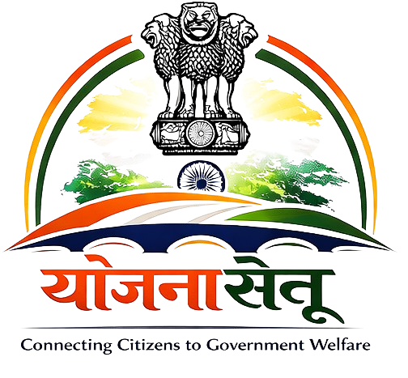

# 🏛️ YojanaSetu — AI-Powered Government Scheme Portal

<p align="center">
  
</p>

<p align="center">
  <b>Connecting citizens with government welfare schemes through AI</b>
</p>

<p align="center">
  
  
  
  
  
</p>

---

## 📌 About the Project

**YojanaSetu** (meaning *Scheme Bridge* in Hindi) is an AI-driven web platform built with Django that bridges the gap between Indian citizens and government welfare schemes.

Citizens can:
- 🔍 **Browse & search** government schemes by category
- 🤖 **Get AI recommendations** via an intelligent chatbot
- 💼 **Explore government job vacancies**
- 📋 **Register** to find personalized schemes based on their profile
- 🌐 **Access state/UT portals** directly from the platform

---

## ✨ Features

| Feature | Description |
|---------|-------------|
| 🏠 **Home Page** | Overview with scheme categories, vacancy dashboard, stats, and essential government portals |
| 📂 **Scheme Categories** | Browse 10+ categories: Education, Health, Farmer, Housing, Women, Employment, Scholarship, etc. |
| 📋 **Scheme Listing** | View detailed scheme info: eligibility, documents required, age requirement, official link |
| 🤖 **AI Chatbot** | Type in natural language (supports multiple languages via auto-translation) to get scheme recommendations |
| 💼 **Vacancy Portal** | Browse government job vacancies organized by category |
| 👤 **User Registration** | Sign up with personal details, profile photo, and eligible categories to get personalized access |
| 🌙 **Dark Mode** | Toggle between light and dark theme — preference saved in browser |
| 🌐 **State Portal Finder** | Find your state/UT government portal directly from footer |

---

## 🛠️ Tech Stack

| Layer | Technology |
|-------|-----------|
| **Backend** | Django 6.x (Python) |
| **Database** | SQLite (dev) |
| **Frontend** | HTML5, CSS3, JavaScript (Vanilla) |
| **AI / Chatbot** | Keyword-based NLP + `deep-translator` for multilingual support |
| **Web Scraping** | `BeautifulSoup4`, `lxml`, `requests` (vacancy scraper) |
| **Image Handling** | Pillow |
| **Icons** | Font Awesome |

---

## 📁 Project Structure

```
yojanasetu/
│
├── manage.py                        # Django entry point
├── requirements.txt                 # Python dependencies
├── .gitignore
│
├── yojanasetu/                      # Project config
│   ├── settings.py
│   ├── urls.py
│   ├── wsgi.py
│   └── asgi.py
│
├── homepage/                        # Home page & About page
│   ├── templates/homepage/
│   │   ├── home.html
│   │   └── about.html
│   ├── static/homepage/
│   │   ├── css/home.css
│   │   └── js/home.js
│   ├── views.py
│   └── urls.py
│
├── schemes/                         # Government schemes app
│   ├── templates/schemes/
│   │   ├── schemes_categories.html
│   │   └── schemes_list.html
│   ├── static/schemes/css/
│   ├── models.py                    # Scheme model
│   ├── views.py
│   └── urls.py
│
├── vacancy/                         # Job vacancies app
│   ├── templates/vacancy/
│   │   ├── vacancycategories.html
│   │   └── vacancylist.html
│   ├── models.py                    # VacancyCategory & Vacancy
│   ├── views.py
│   ├── urls.py
│   └── scraper.py                   # Web scraper for vacancies
│
├── chatbot/                         # AI Chatbot app
│   ├── templates/chatbot/chatbot.html
│   ├── models.py
│   ├── views.py
│   ├── urls.py
│   └── utils.py                     # NLP + translation logic
│
├── user_registration/               # User signup app
│   ├── templates/user_registration/registration_form.html
│   ├── static/registration/
│   ├── models.py                    # CustomUser model
│   ├── views.py
│   └── urls.py
│
└── static/                          # Shared static assets
    └── images/                      # Logo, portal images
```

---

## 🌐 URL Routes

| URL | View | Description |
|-----|------|-------------|
| `/` | `homepage:home` | Home page |
| `/about/` | `homepage:about` | About us |
| `/schemes/` | `scheme_categories` | Browse all scheme categories |
| `/schemes/<category>/` | `schemes_list` | Schemes in a specific category |
| `/schemes/by-category/?category=...` | `scheme_by_category` | Search/filter by category |
| `/chatbot/` | `chatbot_page` | AI chatbot interface |
| `/vacancy/categories/` | `vacancy:category_list` | Browse vacancy categories |
| `/vacancy/category/<slug>/` | `vacancy:vacancy_list` | Vacancies in a category |
| `/registration/register/` | `user_registration:register` | User registration form |
| `/admin/` | Django admin | Admin panel |

---

## ⚙️ Installation & Setup

### Prerequisites

- Python 3.10 or higher
- pip

### 1. Clone the Repository

```bash
git clone https://github.com/YOUR_USERNAME/yojanasetu.git
cd yojanasetu
```

### 2. Create a Virtual Environment (Recommended)

```bash
# Windows
python -m venv venv
venv\Scripts\activate

# macOS / Linux
python3 -m venv venv
source venv/bin/activate
```

### 3. Install Dependencies

```bash
pip install -r requirements.txt
```

### 4. Apply Database Migrations

```bash
python manage.py migrate
```

### 5. Create a Superuser (for Admin Panel)

```bash
python manage.py createsuperuser
```

### 6. Run the Development Server

```bash
python manage.py runserver
```

Open your browser and go to → **http://127.0.0.1:8000**

---

## 🗄️ Database Models

### `Scheme` (schemes app)
| Field | Type | Description |
|-------|------|-------------|
| `name` | CharField | Name of the scheme |
| `category` | CharField | Category (education, health, etc.) |
| `type` | CharField | `central` or `state` |
| `status` | CharField | `active` or `expired` |
| `eligibility` | TextField | Eligibility criteria |
| `age_requirement` | IntegerField | Minimum age |
| `documents_required` | TextField | Required documents |
| `official_link` | URLField | Official government URL |

### `CustomUser` (user_registration app)
| Field | Type | Description |
|-------|------|-------------|
| `full_name` | CharField | Full name |
| `age` | PositiveIntegerField | Age |
| `gender` | CharField | Gender |
| `photo` | ImageField | Profile photo |
| `primary_category` | CharField | Main scheme category |
| `eligible_categories` | TextField | Comma-separated categories |
| `occupation` | CharField | Occupation |
| `phone` | CharField | Phone (used as username) |
| `notify` | BooleanField | SMS/notification preference |

### `VacancyCategory` & `Vacancy` (vacancy app)
Categorized government job listings with title, department, location, salary, last date, and apply link.

---

## 🤖 Chatbot — How It Works

1. User types a message (any language supported)
2. `detect_language()` → identifies the language
3. `translate_to_english()` → translates to English using `deep-translator`
4. `get_casual_response()` → handles greetings/small talk
5. `extract_entities()` → extracts age, state, occupation from message
6. `find_eligible_schemes()` → queries the DB for matching active schemes
7. Response is translated back to the user's language

---

## 📦 Dependencies

```
Django>=6.1
deep-translator>=1.11.4
Pillow>=10.0.0
requests>=2.31.0
beautifulsoup4>=4.12.0
lxml>=5.0.0
certifi>=2024.0.0
```

Install all with:
```bash
pip install -r requirements.txt
```

---

## 🔐 Admin Panel

Access the Django admin at **http://127.0.0.1:8000/admin/**

From admin you can:
- ➕ Add / edit / delete **Schemes**
- ➕ Add / manage **Vacancy Categories** and **Vacancies**
- 👥 View registered **Users**
- 💬 View **Chatbot queries**

---

## 🌙 Environment & Security Notes

> [!WARNING]
> The `SECRET_KEY` in `settings.py` is for **development only**.  
> Before deploying to production:
> - Move `SECRET_KEY` to an `.env` file
> - Set `DEBUG = False`
> - Configure `ALLOWED_HOSTS` with your actual domain
> - Use PostgreSQL instead of SQLite
> - Run `python manage.py collectstatic`

**Recommended production setup:**
```python
# Use python-decouple or django-environ
from decouple import config
SECRET_KEY = config('SECRET_KEY')
DEBUG = config('DEBUG', default=False, cast=bool)
```

---

## 🚀 Deployment Checklist

- [ ] Set `DEBUG = False`
- [ ] Add domain to `ALLOWED_HOSTS`
- [ ] Move `SECRET_KEY` to environment variable
- [ ] Switch to PostgreSQL
- [ ] Run `python manage.py collectstatic`
- [ ] Set up Gunicorn + Nginx (or deploy on Railway/Render/Heroku)

---

## 🤝 Contributing

1. Fork the repository
2. Create your feature branch: `git checkout -b feature/my-feature`
3. Commit your changes: `git commit -m 'Add some feature'`
4. Push to the branch: `git push origin feature/my-feature`
5. Open a Pull Request

---

## 👨‍💻 Team

| Role | Responsibility |
|------|---------------|
| Team Lead | Project vision & lead development |
| AI Engineer | Chatbot & recommendation logic |
| Frontend Dev | UI/UX design & responsive layout |
| Backend Dev | Database & API integration |
| Data Analyst | Scheme verification & data accuracy |

---

## 📜 License

This project is licensed under the **MIT License** — see the [LICENSE](LICENSE) file for details.

---

## 🙏 Acknowledgements

- [Government of India — india.gov.in](https://india.gov.in)
- [MahaDBT](https://mahadbt.maharashtra.gov.in) — Maharashtra scholarship portal
- [MSBTE](https://msbte.org.in) — Technical education board
- [UIDAI](https://uidai.gov.in) — Aadhaar authority
- [deep-translator](https://github.com/nidhaloff/deep-translator) — Multilingual translation

---

<p align="center">
  Made with ❤️ for the citizens of India 🇮🇳
</p>
